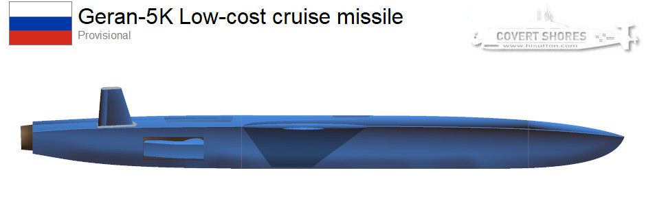
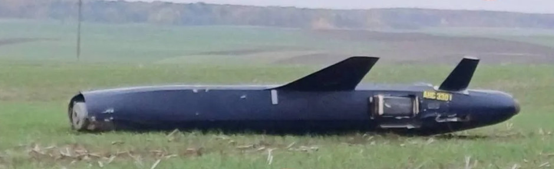
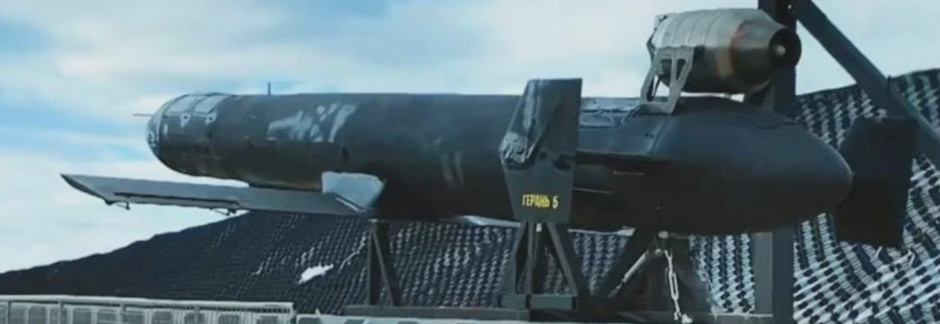
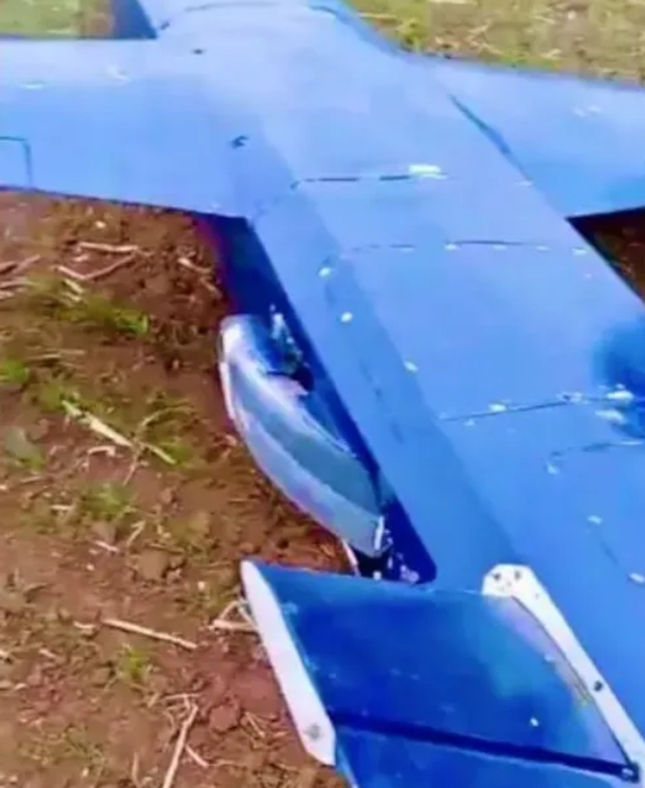
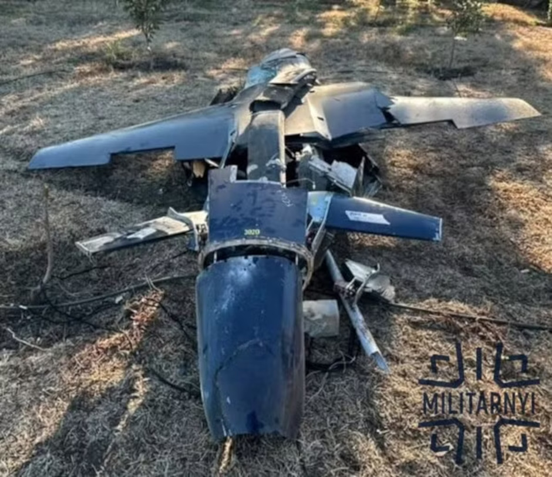
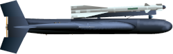
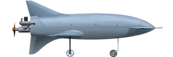

 

 Ukraine has been hit by a completely new Russian cruise missile-drone in recent days, the Geran-5K. Together with the Banderol and [Filin](https://gur.gov.ua/en/content/warsanctions-hur-rozkryvaie-detali-novoi-rosiiskoi-rakety-filin) cruise missiles this represents an incremental step up in the threat to Ukrainian military and civilian infrastructure and civilian population.

 
_The warhead is visible in the nose, with the nose cone removed. The warhead appears to be the same as on the Geran-II (Shahed) / 4 (Jet) and 5 (jet, cruise)._

The type features a completely different airframe to the existing Geran-5 making them appear, outwardly unrelated. But intelligence, likely based on the serial/parts numbers of crashed examples and other non-public information, confirm that it is a Geran-5 in Russian terminology. The Geran name is an indication that it was built at the ginormous Alaguba factory complex which is known for the Geran-II (Shahed) drone.
It has a much neater outer shell than the basic Geran-5, which was reported in [January this year](https://www.hisutton.com/Russian-Geran-5.html)  and remains a major threat to Ukraine. Use of Geran-5s, together with the much improved jet powered Geran-4 version of the delta-wing ‘Shahed’, has increased markedly since around August. 

 
_Older Geran-5_

The original Geran-5 is essentially a tubular fuselage with low-mounted wings and the turbine mounted externally above a bomber-style endplate tail. The new Geran-5K has an angled fuselage to reduce its radar cross-section with high-mounted wings and the turbine buried in the fuselage. Its tail surfaces are a simple ‘V’ type which appears to be mounted lower than 45 degrees from horizontal. 

 
_The high wings and side mounted intake is clearly visible in this view of a crashed example from October 2026_

Geran-5s (and -4s) are already so potent it is unclear what is driving this new design. Work on it must have begun before the Geran-5 was fielded in numbers. One theory could be that this is simply a rival design for the 5th Generation Geran, and that it simply took much longer to develop. Whether its advantages over the Geran-5 warrant large scale implementation is unclear, as is its current production status.

____________________________________________________

**Related articles**  [(Full index of popular Covert Shores articles)]( "Full index of popular Covert Shores articles")  

  Guide to Russia's [Shahed / Geran]() strike drones  

  Ukraine's [long-ranged attack drones (OWA-UAVs)]()  
