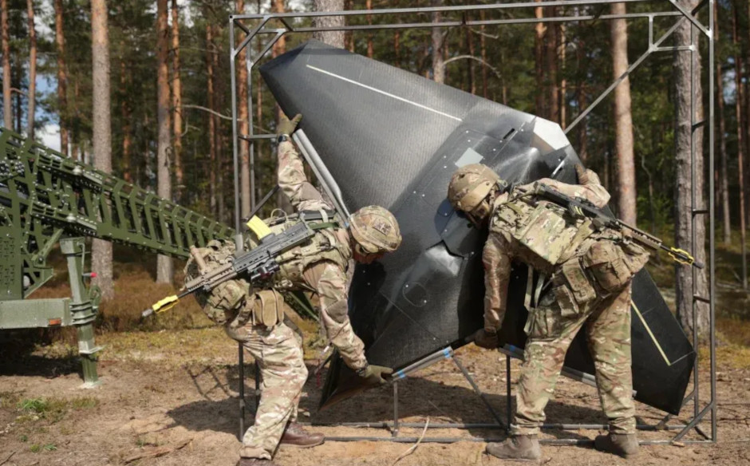
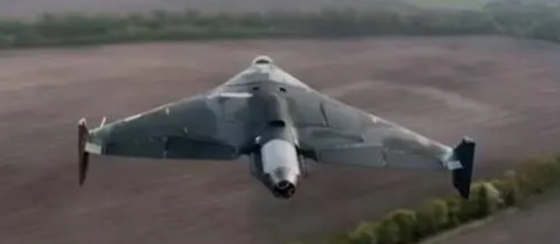
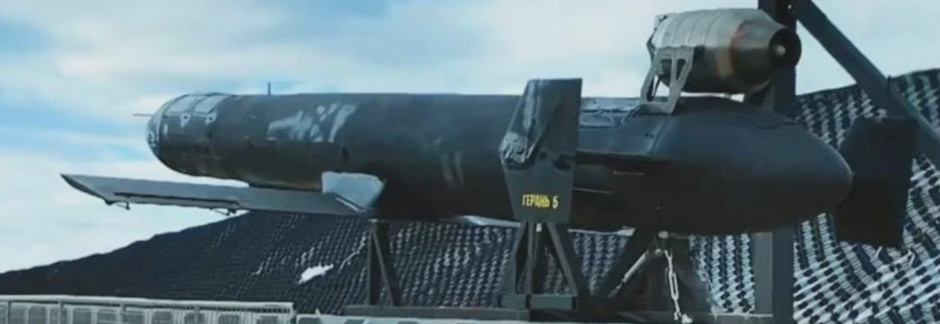
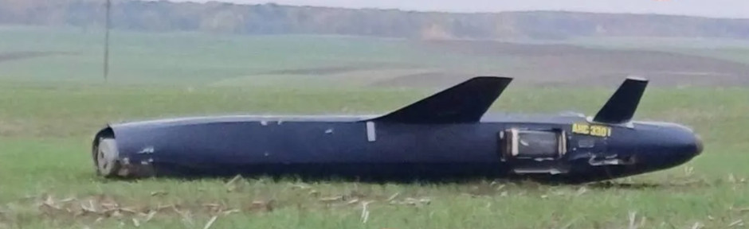
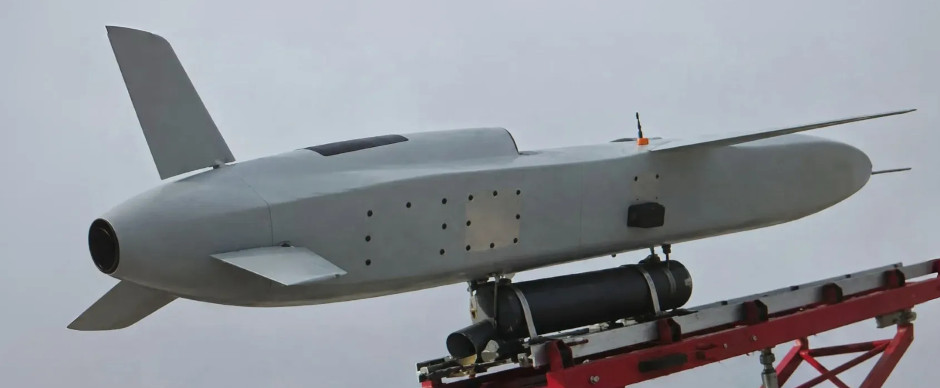
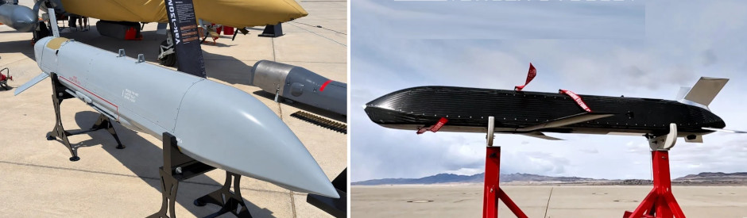
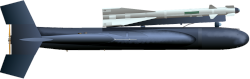
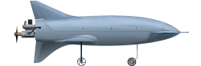

**Updated - originally posted 4th Nov 2026** 

  Both countries have invested in a diverse, yet also mature, range of lower-cost (relatively speaking at least) cruise missiles for deep strikes. The lines between jet-powered drones and missiles are increasingly blurred, and the difference is equally moot. 

Russia’s systems tend to be larger, and longer ranged, with the Ukrainian FP-5 Flamingo being the obvious exception to that rule. The Dutch-built Destinus Ruta promises to close the gap in overall terms however. 

  

*CLICK to Enlarge*

The smallest, or at least the shortest at around 1.5 meters, is the Nyan. The design is a composite-construction flying wing with a commercial off the shelf (COTS) turbine buried in the aft fuselage. 

_The Nyan, seen here during training with British forces._

Currently the two main Russian types are the Geran-4 jet Shahed (much improved over the Geran-3 which it replaced) and more missile-like Geran-5. Geran-5 has a much larger fuselage but lacks the wing volume. They are largely equivalent, built at the same factory in Alaguba, and use the same turbine (jet) so it is unclear whether they’ll continue to build both, or pick one. 

_Russia’s delta-winged Geran-4 can trace its lineage directly back to the Iranian Shahed_

_Russian Geran-5_

The new generation Russian types are the [Geran-5 K5-K](https://www.hisutton.com/Russia-Geran-5K.html) and the Filin. They look similar and are actually approximately the same size, being somewhat smaller than the Geran-5.

_Russian Geran-5K appears much cleaner than the Geran-5, but the relative advantages are unclear. Note missing nose cone in this image._

_The new Russian Filin missile is much smaller than the Geran-5 & 5K, and can use a much lighter launch rail with detachable rocket booster. Simplifications such as ground launch with fixed wings (not folding) are typical measures to make new lower-cost cruise missiles more achievable_

Two air launched types (and air-launched types are normally much more expensive) are the Russian Banderol and Ukrainian-used Rusty Dagger. Similar, except again the Russian one is much larger.

_Russian Banderol (left) and American-built Rusty Dagger (right)_

____________________________________________________

**Related articles**  [(Full index of popular Covert Shores articles)]( "Full index of popular Covert Shores articles")  

  Guide to Russia's [Shahed / Geran]() strike drones  

  Ukraine's [long-ranged attack drones (OWA-UAVs)]()  
