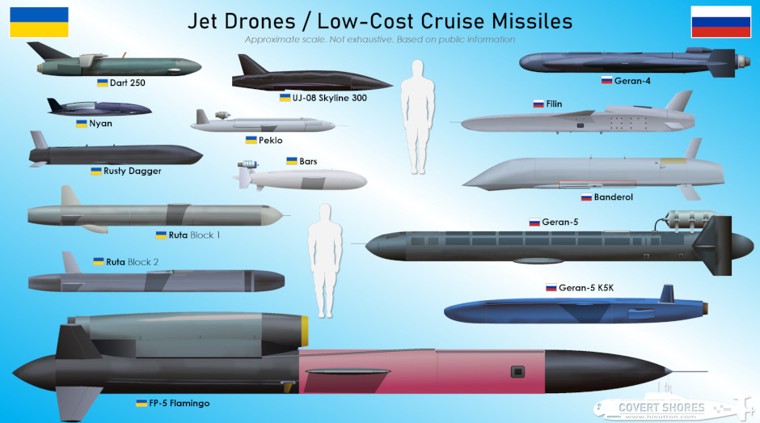

  Both countries have invested in a diverse, yet also mature, range of lower-cost (relatively speaking at least) cruise missiles for deep strikes. The lines between jet-powered drones and missiles are increasingly blurred, and the difference is equally moot. 

Russia’s systems tend to be larger, and longer ranged, with the Ukrainian FP-5 Flamingo being the obvious exception to that rule. The Dutch-built Destinus Ruta promises to close the gap in overall terms however. 

  

*CLICK to Enlarge*

____________________________________________________

**Related articles**  [(Full index of popular Covert Shores articles)]( "Full index of popular Covert Shores articles")  

  Guide to Russia's [Shahed / Geran]() strike drones  

  Ukraine's [long-ranged attack drones (OWA-UAVs)]()  
