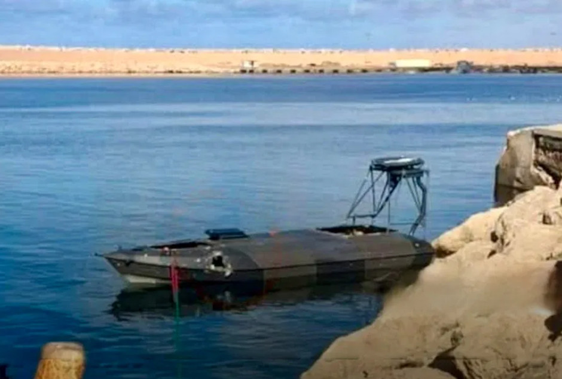
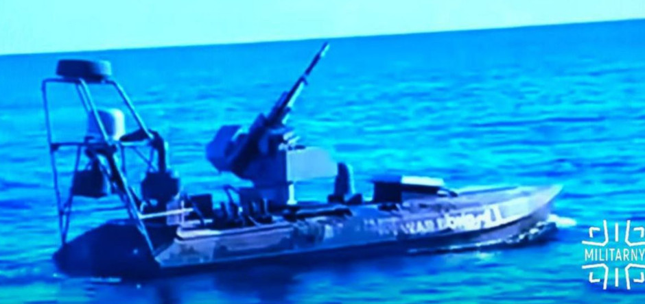
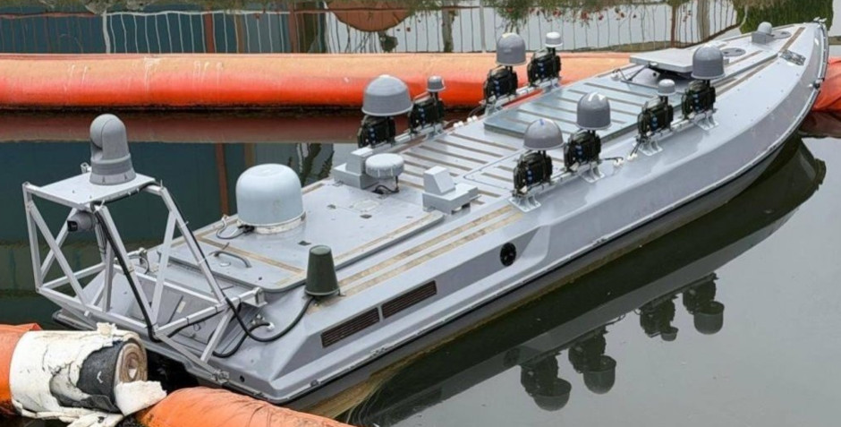
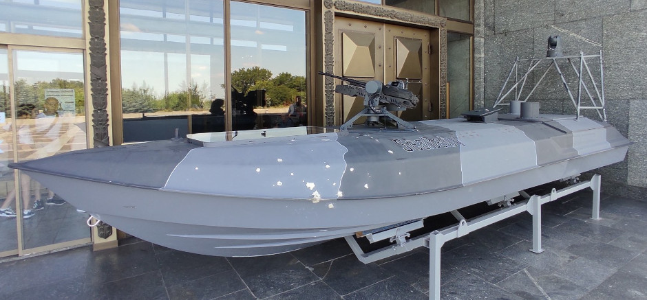
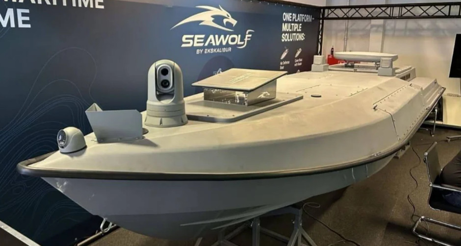
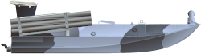
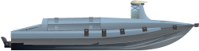
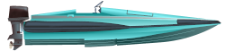

 The spectacular attack on a Russian Navy warship in Benghazi, Libya, was almost certainly conducted by Ukrainian surface drones (USVs). One of the USVs appears to have been disabled and has been photographed by locals. The image, shared online, is credible.

By extension, the USV is also likely the type used in the subsequent attack on a Russian government transport ship off Libya today.

The USV used in the attack was therefore a variant of the family best known as the Sargan-3000. Also known as the Seawolf, and referred to as a ‘Sea Baby-II’ in SBU service. 

## Reference Images of Sea Baby-II / Sargan-3000 / Sea Wolf

_Example with remote weapon station (RWS) in service with Ukraine's SBU. It may have 'Sea Baby II' painted on the side._ 

_Example washed up in Romania. This one has an electromagnetic warfare (EW) fit._ 

_Example on display in Kyiv. This one has a remote weapon station. PhotoHosaka Sanshiro_ 

_Example on display at an arms show as 'Sea Wolf'._ 

____________________________________________________

**Related articles**  [(Full index of popular Covert Shores articles)]( "Full index of popular Covert Shores articles")  

  Guide to Ukraine's [naval drones (USVs)]()  

  Guide to Russia's [naval drones (USVs)]()  

  Houthi's Blowfish: Guide To [Explosive USV]() Threat Off Yemen  

